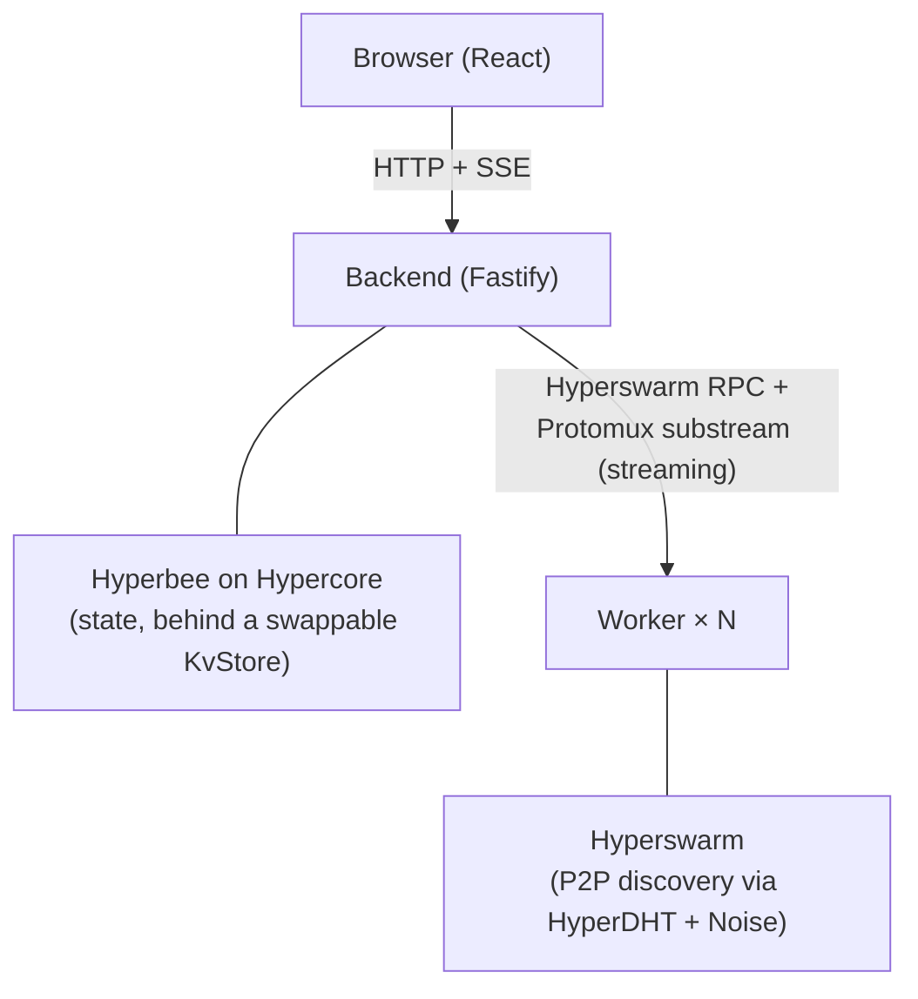

<div align="center">

# Cosmic — Distributed GPU Cloud Service

[](https://github.com/ileopoldes/cosmic-take-home/actions/workflows/ci.yml)
[](https://holepunch.to/)
[](https://github.com/holepunchto/hyperswarm)
[](https://github.com/holepunchto/hypercore)
[](https://github.com/holepunchto/hyperbee)
<br />
[](https://nodejs.org/)
[](https://fastify.dev/)
[](https://react.dev/)
[](https://www.typescriptlang.org/)
[](https://www.docker.com/)

A simplified, decentralized AI PaaS built on the Holepunch P2P stack. Demonstrates API key management, OpenAI-compatible inference, and workload distribution across simulated GPU "worker nodes".

> **Note:** Take-home assignment for the **Senior Fullstack Software Engineer** role at Tether Operations Limited. Scope: 2 days. See [`CLAUDE.md`](./CLAUDE.md) for the full project brief and operating procedure.

</div>

---

## Reviewer quickstart

> **Canonical branch:** `main`. Evaluate the tip of `main` (a `submission-v0`
> tag marks the SHA submitted for review).
>
> **Tested on:** macOS 15.x / Linux Debian 12 with **Docker Desktop 4.x** (or
> Engine 24+), **Node 22.x** (`.nvmrc` provided), **pnpm 9.x** via `corepack`.
> Apple Silicon and x86_64 both work; if `rocksdb-native` prebuilds fail on
> your host architecture, pin `platform: linux/amd64` on the backend/worker
> Compose services and rebuild.
>
> **One-shot smoke:**
>
> ```bash
> nvm use && corepack enable
> pnpm install
> cp .env.example .env       # empty values are fine — see "Troubleshooting"
> pnpm compose:up            # docker compose up --build
> # wait ~30–60 s for the swarm to form, then:
> curl -s :3000/health | jq    # expect p2p.peers >= 3
> ```

---

## High-Level Architecture



- **Backend** acts as a dispatcher. It exposes OpenAI-compatible endpoints and routes inference work to available workers via Hyperswarm RPC.
- **Workers** are independent Node processes that join the same Hyperswarm topic and stream synthetic tokens (mock LLM) for inference requests.
- **State** lives in **Hyperbee on Hypercore** behind a `KvStore` interface (`apps/backend/src/state/`). The interface keeps a future swap to HyperDB feasible. Stored namespaces: worker registry, API keys (hashed), job state, usage records.
- **Frontend** is a React + Vite dashboard for API key management, an inference playground, and live usage metrics.
- **Streaming transport.** `@hyperswarm/rpc` carries `inference.run` and `worker.health` (request/response). `inference.stream` uses a Protomux channel over the encrypted Hyperswarm session for token-by-token streaming. The decision and trade-offs are documented in [`docs/architecture.md`](./docs/architecture.md) §2.3.

For the architectural decisions, trade-offs, and scalability considerations, see [`docs/architecture.md`](./docs/architecture.md). Live progress is tracked in [`docs/requirements-tracking.md`](./docs/requirements-tracking.md).

---

## Built With

- [](https://holepunch.to/) - P2P discovery and streaming
- [](https://fastify.dev/) - Backend API dispatcher
- [](https://react.dev/) - Dashboard UI
- [](https://vitejs.dev/) - Frontend tooling

---

## Repository Layout

```text
.
├── apps/
│   ├── backend/    # Fastify API + dispatcher
│   ├── frontend/   # React + Vite dashboard
│   └── worker/     # Hyperswarm peer (mock LLM)
├── packages/
│   └── shared/     # Compact-encoding schemas, DTOs, topic constants
├── docker/         # Dockerfiles for each app
├── docs/           # Architecture document + diagrams
├── .cursor/rules/  # AI assistant rules
├── .github/workflows/  # CI/CD
├── docker-compose.yml  # 1 backend + ≥3 workers
└── CLAUDE.md       # AI assistant north-star
```

---

## Prerequisites

- **Node.js 22+** (`.nvmrc` provided — run `nvm use`).
- **pnpm 9+** (`corepack enable && corepack prepare pnpm@9.12.0 --activate`).
- **Docker + Docker Compose** (for the distributed simulation).

---

## Quick Start (Native)

**1. Install dependencies**

```bash
nvm use
pnpm install
```

**2. Configure environment**

```bash
cp .env.example .env
# (Optionally generate a real P2P topic and HMAC secret per comments in .env.example)
```

**3. Run the apps (in separate terminals)**

```bash
pnpm --filter @cosmic/backend dev
pnpm --filter @cosmic/worker dev
pnpm --filter @cosmic/frontend dev
```

**4. Visit the dashboard and API docs**

```bash
open http://localhost:5173        # frontend
open http://localhost:3000/docs   # OpenAPI / Swagger UI
```

---

## Quick Start (Docker Compose — Distributed Simulation)

**1. Configure environment**

```bash
cp .env.example .env
```

**2. Start the swarm**

```bash
pnpm compose:up         # docker compose up --build
```

> 1 in-Compose HyperDHT bootstrap node + 1 backend + 3 workers + 1 frontend (nginx).
> All containers join the same Hyperswarm topic; the bootstrap node keeps DHT announcements on the bridge network so peers find each other reliably (see `docs/architecture.md` §4.1 for the bridge-NAT / hairpinning rationale).

**3. Stop the swarm (when done)**

```bash
pnpm compose:down       # docker compose down -v
```

If you need to test against the **public Holepunch DHT** instead (e.g. multi-host deployments where each container has a routable IP), opt out of the in-Compose bootstrap by setting `P2P_BOOTSTRAP` to an empty string:

```bash
P2P_BOOTSTRAP= docker compose up --build
```

You can also point at any external bootstrap by exporting `P2P_BOOTSTRAP=host:port[,...]` before `docker compose up`.

---

### Smoke run

With Compose up, exercise the full pipeline end-to-end:

**1. Confirm the swarm formed**

```bash
curl -s :3000/health | jq          # peers should be ≥ 1 within ~30s
```

**2. Create an API key** (public for the take-home; see architecture.md §4)

```bash
KEY=$(curl -s -X POST :3000/v1/api-keys \
  -H 'Content-Type: application/json' \
  -d '{"name":"smoke"}' | jq -r .plaintext)
```

**3. Dispatch a non-streaming inference**

```bash
curl -s -X POST :3000/v1/chat/completions \
  -H "Authorization: Bearer $KEY" \
  -H 'Content-Type: application/json' \
  -d '{"model":"mock-llm","messages":[{"role":"user","content":"hi"}]}' | jq
```

Expected output: an OpenAI-shaped `chat.completion` with synthetic text, `finish_reason: "length"`, and non-zero `usage.total_tokens`.

---

## Troubleshooting

A reviewer following the Compose quick-start should see all 6 services healthy
within ~60 s. If that doesn't happen, these are the most common failure modes
and how to diagnose them quickly.

**Cold-start window — `/health` reports `peers: 0` immediately.**
Hyperswarm peer discovery takes 5–30 s after `pnpm compose:up`. Watch the
backend log for `p2p.peer_added` lines first; only then curl `/health`.

```bash
docker compose logs -f backend | grep p2p.peer_added
```

You should see three `p2p.peer_added` lines (`peers: 1`, `2`, `3`) within
roughly 30 seconds. `/metrics` then reports `workers.connected = 3` and
`workers.capacity = 12` (4 capacity per worker × 3 workers).

**`/health` keeps reporting `peers: 0` for more than 60 s.**

1. Check the DHT bootstrap is healthy: `docker compose ps dht` should be
   `healthy` and `docker compose logs dht` should include
   `dht.ready { host: '...', family: 4, port: 49737 }`. If the port is
   anything other than `49737`, the DHT container could not bind — check
   that nothing else on the bridge is grabbing the port.
2. Verify the workers connected to the bootstrap:
   `docker compose logs worker1 | grep rpc.ready` — each worker should
   log one `rpc.ready` line within 1 s of boot.
3. If everything boots cleanly but discovery still doesn't form, you may
   be in a sandboxed UDP environment (some corporate VPNs block DHT
   traffic). The in-Compose default keeps DHT traffic on the bridge
   network and should work, but if `dht.ready` itself never appears,
   `docker compose down -v && docker compose up --build` and retry.

**Backend logs `worker.health poll failed` / `RPCError: CHANNEL_CLOSED` /
`worker.soft_removed`.** This is the symptom of a misaligned DHT
bootstrap topology. If you see this on `main`, please open an issue;
the in-Compose path is covered by `pnpm compose:smoke`.

**`.env.example` placeholders.** The shipped `.env.example` has every
value either set to a sane default or empty (the backend's config loader
falls back to a deterministic dev topic, dev HMAC, etc.). If you replace
`P2P_DISCOVERY_TOPIC` with a custom value, it must be **exactly 32 bytes
when base64-decoded** — the config loader fails fast with a precise
error message if not. Generate one with:

```bash
node -e "console.log(require('crypto').randomBytes(32).toString('base64'))"
```

**Native deps on Apple Silicon.** `rocksdb-native` ships prebuilds for
`linux-amd64` and `linux-arm64`. Docker Desktop on Apple Silicon runs
amd64 images under qemu by default; if that's slow or unstable for you,
add `platform: linux/arm64` to the backend and worker services in
`docker-compose.yml`.

**Submission zip.** Generate a reviewer-friendly archive from the current
commit with `pnpm zip` (or `git archive --format=zip HEAD -o cosmic.zip`).

---

## Available Scripts

```bash
pnpm dev            # run all apps in parallel (dev mode)
pnpm build          # build all apps
pnpm test           # run all tests in WATCH mode (vitest)
pnpm test:run       # run all tests once (vitest run) — use this in CI / pre-commit
pnpm lint           # lint all apps
pnpm typecheck      # typecheck all apps
pnpm format         # write Prettier formatting
pnpm format:check   # verify Prettier formatting
pnpm compose:up     # docker compose up --build
pnpm compose:down   # docker compose down -v
pnpm clean          # remove dist + node_modules
```

---

## Status

CI runs lint → typecheck → test → build → format check on every push to `main` and every PR (`.github/workflows/ci.yml`).

---

## Why no Turborepo / Nx?

We deliberately use plain **pnpm workspaces** without a higher-level orchestrator. The dependency graph is shallow (`@cosmic/shared` → backend / worker / frontend) and only four packages exist, so `pnpm -r --parallel --filter` already gives us parallel execution and per-package targeting. Adding Turbo/Nx would buy build caching at the cost of one more concept to explain in the demo video. Trivial to introduce later — see `docs/architecture.md` for the trade-off discussion.

---

## Environment Variables

See [`.env.example`](./.env.example) for the full list.

---

## Documentation

- **[CLAUDE.md](./CLAUDE.md)** — AI assistant brief (read this first).
- **[Architecture](./docs/architecture.md)** — design, trade-offs, scaling, future work.
- **[OpenAPI Spec](http://localhost:3000/docs)** — generated OpenAPI spec (when backend is running).
- **[AI Rules](./.cursor/rules)** — coding/architecture/testing rules used by the AI assistant.

---

## License

This is a take-home assignment — not licensed for production use.
