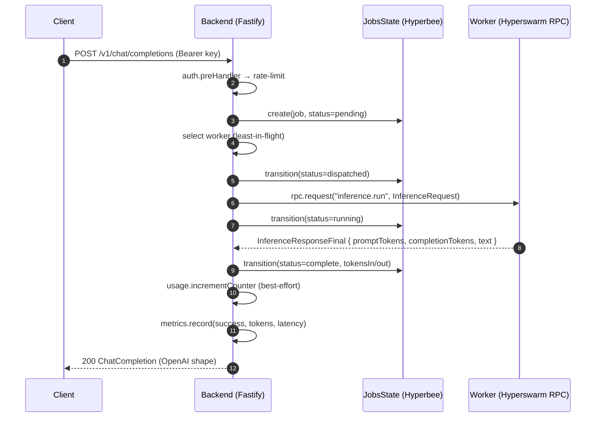
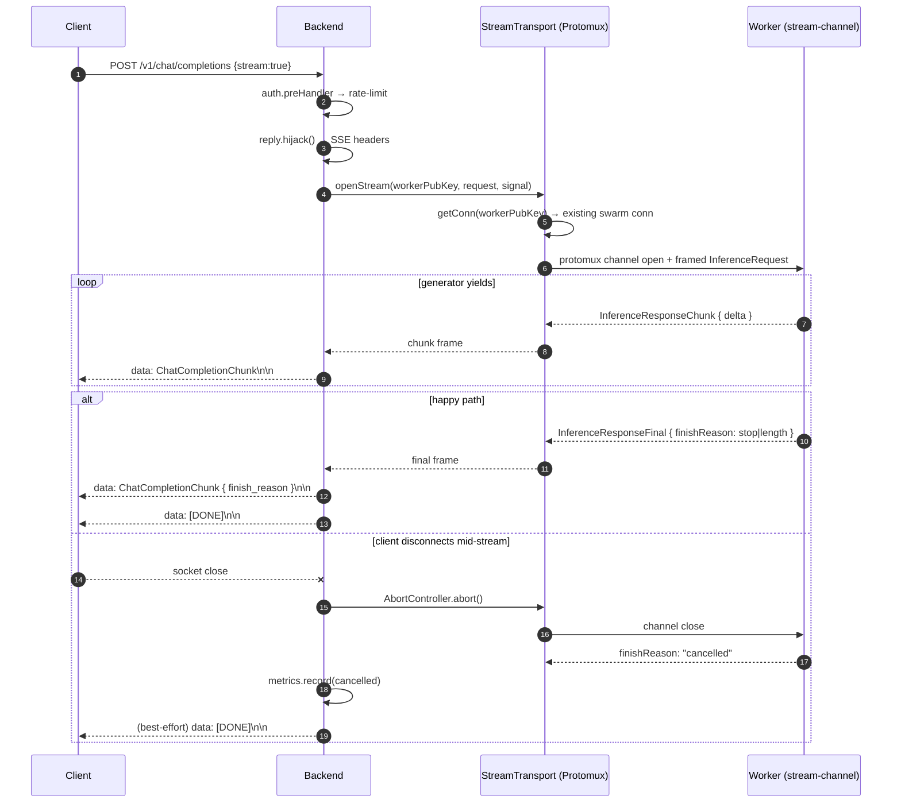
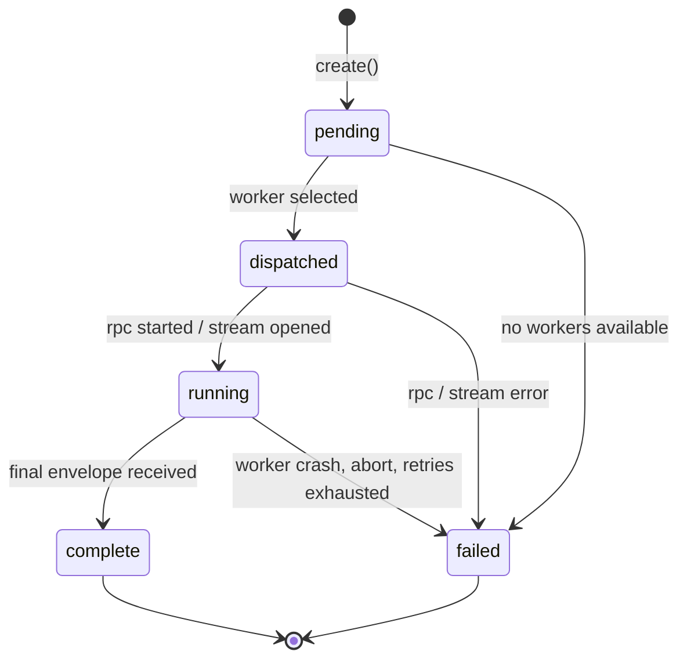

# Cosmic GPU Cloud — Architecture

> Living document. It will be appended to as each subsequent step lands. The intent is for the reviewer to find every architectural decision, trade-off, and known gap in **one** place rather than discovering them through code comments.

## 1. System Design

The platform is split into three runtime processes plus shared contracts:

```text
┌────────────┐     HTTP/JSON + SSE      ┌────────────────────────────┐    Hyperswarm RPC + Protomux     ┌────────────┐
│  Frontend  │ ───────────────────────► │ Backend (Fastify dispatcher)│ ────────────────────────────────►│  Worker(s) │
│  (React)   │ ◄───────────────────────│  + Hyperbee state store     │ ◄────────────────────────────────│ (mock LLM) │
└────────────┘                          └────────────────────────────┘                                  └────────────┘
                                              ▲
                                              │ Compact Encoding wire format (`packages/shared`)
                                              ▼
                                       ┌──────────────┐
                                       │ HyperDHT     │
                                       │ (discovery)  │
                                       └──────────────┘
```

- **Backend** (`apps/backend`) — Fastify HTTP API. Owns auth, rate-limiting, request validation, dispatch decisions, and SSE bridging. Persists state in Hyperbee on Hypercore behind a `KvStore` interface (see `apps/backend/src/state/`).
- **Worker** (`apps/worker`) — Joins the Hyperswarm topic, exposes RPC methods (`inference.run`, `inference.stream`, `worker.health`), generates synthetic tokens. Will be wired in Step 5.
- **Frontend** (`apps/frontend`) — React/Vite dashboard for keys, playground, and usage. Will be wired in Steps 9–10.
- **Shared** (`packages/shared`) — TypeBox HTTP DTOs, Compact Encoding RPC schemas, constants, error codes. The single source of truth for cross-process contracts.

## 2. Distributed Approach

### 2.1 Discovery (Hyperswarm)

All nodes (backend + workers) join a shared 32-byte topic, configured via `P2P_DISCOVERY_TOPIC`. The **backend** announces with `client: true, server: true` (it is the canonical server for its own keypair on the topic). **Workers** join the same topic as `client: true, server: false` — they connect outwards to find the backend, but they do **not** register their own keypair as a swarm listener. NAT traversal is automatic via HyperDHT.

Why workers are client-only on the swarm: the worker's `@hyperswarm/rpc` server already registers the worker's keypair as a listener on its own DHT instance (`rpc.createServer().listen(keyPair)`). If the swarm ALSO registered the same keypair on `swarm.dht` (`swarm.join(topic, { server: true })`), the same pubkey would be advertised twice on the shared bootstrap. Backend `dht.connect(workerPubKey)` lookups would round-robin between the two listeners; the swarm listener accepts a raw NoiseSecretStream that has no Protomux RPC handlers wired, so RPC framing fails with `RPCError: CHANNEL_CLOSED` / `CHANNEL_DESTROYED` and the registry soft-removes the worker. The single-listener architecture (RPC owns the keypair on the DHT; swarm carries the outbound conn for the topic-mesh + the Protomux streaming channel) eliminates that failure mode. See `apps/worker/src/runtime/swarm.ts` for the in-code rationale.

For local Compose runs we expose `P2P_BOOTSTRAP` (comma-separated `host:port` list). The Compose default substitutes `dht:49737` (`${P2P_BOOTSTRAP:-dht:49737}` — `:-` so a `cp .env.example .env` with an empty value still substitutes). To opt into the public Holepunch DHT for native multi-host deployments, point `P2P_BOOTSTRAP` at a real external bootstrap. Backend, worker swarm, and the worker's `@hyperswarm/rpc` server **all** receive the same bootstrap list so they share the same DHT routing topology — without that alignment, the RPC server's separate DHT silently falls back to mainnet and backend lookups can't reach it.

### 2.2 Identity

Every node persists a 32-byte ed25519 **seed** at `NODE_KEYPAIR_PATH`. On boot, the seed is loaded and a real `{ publicKey: Buffer(32), secretKey: Buffer(64) }` keypair is derived via `HyperDHT.keyPair(seed)` (libsodium `crypto_sign_seed_keypair`). The keypair is the same across restarts, so the worker registry's `workers/<pubkey>` rows remain stable, and Step 5 can pass the keypair directly to Hyperswarm. Public keys logged or shown in the UI are truncated to 8 hex chars + `…`.

### 2.3 Transport Split (RPC vs streaming)

`@hyperswarm/rpc` is a request/response RPC layer; it does not natively support streamed responses. We deliberately split the transport:

- **`@hyperswarm/rpc`** — `inference.run` (non-streaming completions) and `worker.health` (heartbeat).
- **Protomux channel** over the encrypted Hyperswarm secret stream — `inference.stream` (token-by-token streaming). Each chunk is a Compact-Encoded `InferenceResponseChunk`; the channel terminates with an `InferenceResponseFinal`. Cancellation is propagated by closing the channel; the worker observes the close and aborts its generator.

Both transports run on top of the same Noise-encrypted Hyperswarm session. The split is documented in `.cursor/rules/p2p-architecture.mdc` so the rule and this document agree.

### 2.4 State (Hyperbee on Hypercore, with HyperDB awareness)

The `KvStore` interface (`apps/backend/src/state/types.ts`) abstracts over two adapters:

- **In-memory** — used in tests and ephemeral dev (`STATE_BACKEND=memory`). Map-backed, deep-cloned values.
- **Hyperbee** — used in production (`STATE_BACKEND=hyperbee`). Single Hyperbee tree on a single Hypercore on disk, JSON-encoded values.

Typed accessors on top of `KvStore` (`api-keys`, `workers`, `jobs`, `usage`) keep the rest of the code backend-agnostic. Hypercore's signed Merkle trees provide integrity verification for free; sparse replication is the Hyperbee default and would activate automatically if we wired multi-peer state replication (see §6).

**HyperDB vs Hyperbee — why we chose Hyperbee.** The brief explicitly names `hyperdb` as the distributed K/V store. We evaluated the current package (`hyperdb@6.x`, March 2026) against our needs:

- HyperDB 6.x is a **schema-first document database** with named collections, indexes, and a build-time codegen step (`hyperdb/builder` + `hyperschema`). The runtime API is collection-scoped (`db.insert(collection, doc)`, `db.get(collection, queryObject)`, `db.find(collection, range)`), and `db.flush()` is mandatory to persist a batch.
- Internally, the P2P-aware `HyperDB.bee(core, definition)` engine wraps a Hypercore directly — it inherits the same append-only, signed-merkle-tree, sparse-replication semantics that Hyperbee provides. From a _distributed-systems_ perspective the two share the same substrate; HyperDB's value-add is the schema + indexing layer above it.
- Our state shape is generic: string keys (`api-keys/<id>`, `workers/<pubkey>`, `jobs/<id>`, `usage/<keyId>/<windowStart>`) mapping to JSON values. We do not benefit from collection-typed records or index-driven queries today. Forcing a schema on top would mean shipping generated codegen artefacts for negligible gain.
- The `KvStore` interface keeps a future migration to a properly-typed HyperDB layout (one collection per resource, indexed by id and createdAt) feasible the day we need typed queries.

A runnable [HyperDB awareness demo](../apps/backend/scripts/hyperdb-demo/README.md) exercises `hyperdb@6.x` end-to-end (open Hypercore → `HyperDB.bee` → insert / get / find / delete / flush). Run it with `pnpm --filter @cosmic/backend demo:hyperdb`. It is intentionally _not_ wired into the backend runtime — it is documentation in runnable form, the evidence behind this trade-off.

### 2.5 Wire format (Compact Encoding)

All RPC payloads are Compact Encoded with codecs in `packages/shared/src/schemas/`. The schema policy is **append-only**: never reorder or remove fields. New fields are added at the end and made optional so older writers still produce valid wire frames. Floats (e.g. `temperature`, `topP`) are encoded as fixed-point integers (×1000) so the wire stays integer-only; this rounds to 3-decimal precision (see Trade-offs §4).

### 2.6 Workload distribution

The backend acts as a dispatcher (Step 6). Worker selection is least-in-flight with random tie-break, sourced from the local `WorkersState` accessor. Job state transitions are persisted in `JobsState` (`pending → dispatched → running → complete | failed`). A worker that misses a heartbeat for the configured TTL is soft-removed and any in-flight job is re-dispatched to another worker (non-streaming path) or surfaced to the client as an error event (streaming path).

**Transport topology across backend + worker.**

- **Backend RPC client** reuses `swarmHandle.swarm.dht` for outbound `dht.connect(workerPubKey)` lookups. The swarm has already populated its routing table via `swarm.join(topic)`, so reusing it makes RPC requests resolve immediately. Sharing is safe because the backend never calls `dht.createServer().listen(keyPair)` — the `KEYPAIR_ALREADY_USED` constraint that applies to listeners doesn't apply to clients.
- **Backend streaming transport** does NOT open a fresh `dht.connect()` per stream. Instead, `WorkerRegistry.getConn(workerPubKey)` returns the existing Hyperswarm connection the worker established when it joined the topic; the streaming transport attaches `Protomux.from(conn)` and opens the `cosmic/inference-stream/v1` channel on that connection. This is the same connection the worker's `attachStreamChannelServer` registered the channel handler on, so the channel opens immediately. The previous implementation (fresh `dht.connect` per stream) landed on the worker's RPC DHT listener — where the streaming protocol is not registered — and timed out silently. See `apps/backend/src/p2p/stream-transport.ts` for the in-code rationale.
- **Worker RPC server** keeps its own HyperDHT instance because `rpc.createServer().listen(keyPair)` DOES register a listener for that keypair. Reusing the swarm's DHT here would trigger `KEYPAIR_ALREADY_USED`. The RPC server's DHT receives the same `P2P_BOOTSTRAP` list as the swarm so both routing topologies converge on the same bootstrap node.

#### 2.6.1 Non-streaming inference sequence



#### 2.6.2 Streaming inference sequence (with client-disconnect cancellation)

Streaming uses a Protomux substream (`cosmic/inference-stream/v1`) over the encrypted Hyperswarm secret stream (§2.3). Cancellation propagates by closing the channel.



#### 2.6.3 Job lifecycle state machine

`JobsState.transition(...)` (`apps/backend/src/state/jobs.state.ts`) enforces the following state machine.



## 3. Failure Scenarios and Resilience

| Scenario                         | Response                                                                                                                                                                                                                                                                                                 |
| -------------------------------- | -------------------------------------------------------------------------------------------------------------------------------------------------------------------------------------------------------------------------------------------------------------------------------------------------------- |
| All workers offline              | Backend returns `503 NoWorkersAvailable` with `Retry-After`; the request is not queued in the MVP.                                                                                                                                                                                                       |
| Worker disappears mid-stream     | Backend terminates the SSE connection with a final `data: {error: WorkerTimeout}` event. No silent reconnection.                                                                                                                                                                                         |
| Client disconnects mid-stream    | Backend's route hooks `request.raw.on('close')` → `AbortController.abort()`; the dispatcher's `dispatchStream` finally-block closes the Protomux channel; the worker's generator observes the close and emits `finishReason: 'cancelled'`. Job transitions to `failed` and `inference.failed` is logged. |
| Worker disappears mid non-stream | Backend re-dispatches once to another worker; on second failure, returns `503 WorkerTimeout`.                                                                                                                                                                                                            |
| Topic mismatch / no peers found  | Backend's `p2p.watchdog.no_peers` warn fires once at 30 s with an actionable checklist (dht service health, worker `rpc.ready`, topic match, bootstrap match); `p2p.connected: false` on `/health`; `/ready` returns 503 `no_peers` until at least one worker registers.                                 |
| Hyperbee write conflict          | Last-write-wins with monotonic ISO timestamps on every record. Documented as a single-writer simplification.                                                                                                                                                                                             |
| Rate limit exceeded              | `429` envelope with `Retry-After`; per-key bucket.                                                                                                                                                                                                                                                       |
| Invalid bearer                   | `401 ApiKeyInvalid` envelope; revoked keys yield `403 ApiKeyRevoked`.                                                                                                                                                                                                                                    |

## 4. Trade-offs and Deliberate Divergences

These are intentional choices that differ from the original implementation plan or the most common production pattern. Each one is recorded so the reviewer doesn't have to spelunk through code comments.

- **Plain Node.js, not Pear Runtime / Bare.** The original implementation plan recommends Pear; we chose plain Node.js because Pear modules are explicitly described as potentially "unstable" and a 2-day window punishes ecosystem risk. Pear migration is captured as future work in `.cursor/rules/pear-runtime.mdc`.
- **Hyperbee on Hypercore, not HyperDB.** `hyperdb@6.x` is a schema-first document database with codegen-driven definitions; our generic key-string → JSON-value workload doesn't benefit from the schema layer. We use Hyperbee directly (the engine HyperDB itself sits on for its `bee` backend) and keep a future HyperDB swap feasible behind the `KvStore` interface. Detailed reasoning + a runnable HyperDB awareness demo: see §2.4 and `apps/backend/scripts/hyperdb-demo/`.
- **Single-writer Hyperbee, not multi-peer replication.** The MVP holds state in one Hyperbee instance on the backend. Multi-writer state via `corestore` and per-worker Hypercore feeds is captured under §6 Future Improvements.
- **Public API key management endpoints** (`POST/GET/DELETE /v1/api-keys` are not Bearer-protected). Without this, the first key creation is impossible without an out-of-band admin token. Production hardening (admin token, mTLS, or signed-installer flow) is captured under §6.
- **In-memory rate limiter.** `@fastify/rate-limit` v10 with the default in-memory store means rate counters reset on restart and are not shared across multiple backend replicas. For a single-instance demo this is fine. For production, swap the store to Redis or a Hyperbee-backed sliding window (counter would live at `usage/<keyId>/<windowStart>` which we already model).
- **Mock LLM, not a real model.** Workers stream synthetic tokens. Real model serving is explicitly out of scope per the task brief.
- **Synchronous in-process error mapping.** A single Fastify error handler maps `DomainError` / validation / 429 / unknown to the shared `ApiErrorBody` envelope. We deliberately avoid spreading error formatting across handlers.
- **Fixed-point float encoding (×1000).** Inference parameters such as `temperature` and `topP` are encoded over RPC as `cuint` after multiplying by 1000. This rounds to 3-decimal precision, which is well within the OpenAI contract's tolerance and keeps the wire integer-only.
- **Mark & Sweep GC, Fork-ID truncate handling, and signed RPC results are deferred.** All three are captured in `.cursor/rules/p2p-architecture.mdc` and §6 below. We never call `core.truncate`, so Fork-ID drift cannot occur in the MVP by construction.
- **Study guide note: "encrypted with private key, decrypted with public key".** That phrasing in the study guide describes a digital signature, not encryption. Hyperswarm sessions use **Noise** (an asymmetric handshake that derives symmetric session keys); confidentiality is symmetric, authenticity is asymmetric. Calling this out so reviewers don't think we adopted a wrong mental model.

## 4.1 Local Compose details

`docker-compose.yml` ships **self-contained by default**: a small `dht` service runs an in-Compose HyperDHT bootstrap node, and every backend / worker container sets `P2P_BOOTSTRAP=dht:49737`. This avoids Docker bridge-NAT hairpinning issues (see below) and works offline.

```bash
docker compose up --build              # default: in-Compose DHT bootstrap
```

The `dht` service uses `HyperDHT.bootstrapper(49737, ownHost)` — the documented entrypoint for an isolated bootstrap node (see `node_modules/hyperdht/bin.js`). It pins the listen port to 49737 (failing fast if `addr.port !== 49737`), writes `/tmp/dht.ready` after `ready()`, and exposes a Compose `healthcheck: test ['CMD', 'test', '-f', '/tmp/dht.ready']`. Backend and workers `depends_on: { dht: { condition: service_healthy } }` so they never start before the bootstrap is actually accepting connections. An earlier iteration used `new HyperDHT({ port: 49737 })`; that's an ordinary DHT peer that bootstraps from mainnet and binds a random local port, so swarm peers pointing at `dht:49737` connected to nothing.

**Why self-contained by default — a Docker bridge-NAT note.** When every node lives on the same Docker bridge (the typical laptop demo), each container's HyperDHT announce records the **host's** external NAT address, not the container's bridge-internal IP. Looking each other up through the public DHT therefore returns external addresses that the bridge can't reach back unless the host router supports NAT hairpinning — which most consumer setups don't. The result is a silent failure: every node announces successfully, no errors are logged, but `swarm.on('connection')` never fires because the UDP packets never arrive. Running an in-Compose `dht` service keeps announcements on bridge-internal IPs (`172.x.x.x`), which the bridge happily routes between containers.

**Bash parameter expansion gotcha.** Compose substitutes `P2P_BOOTSTRAP: ${P2P_BOOTSTRAP:-dht:49737}` — the `:-` form falls back when the variable is unset OR empty. The previous form `${P2P_BOOTSTRAP-dht:49737}` only fell back when unset, so a fresh `cp .env.example .env` (which ships `P2P_BOOTSTRAP=` empty) defeated the default and pushed every peer onto the public DHT.

Named volumes (`backend-data`, `worker[1-3]-data`) persist Hyperbee/Hypercore state and node-identity seeds across container restarts so worker pubkeys stay stable.

## 4.2 Operating notes

A few container-runtime details that surfaced during the Compose hardening pass and are worth knowing if you fork the Dockerfiles:

- **`libatomic1` is required at runtime.** Holepunch's `rocksdb-native` (a transitive dep through `udx-native` → `dht-rpc` → `hyperdht`) needs `libatomic.so.1` at `dlopen` time on Linux. The `node:22-bookworm-slim` base image doesn't ship it, so the `runtime` stage in `docker/{backend,worker}.Dockerfile` installs `libatomic1` explicitly. Without it, the prebuild's `dlopen` fails and the `require-addon` resolver surfaces a misleading `MODULE_NOT_FOUND` for one of the fallback candidate paths instead of the actual `libatomic` error.
- **Containers run as the unprivileged `node` user.** Both Dockerfiles `mkdir -p /data && chown -R node:node /data` before declaring the `VOLUME ['/data']` so the named volume's mountpoint is owned by uid 1000. Without this, the runtime crashes with `EACCES: permission denied, mkdir '/data/state'` on the first Hyperbee write because Docker initialises a brand-new named volume as `root:root`. Note this only affects the **first** attach — if you've previously created a volume under a buggier image, you need `docker compose down -v` to drop it before the new image's ownership takes effect.
- **In-Compose `dht` service runs from `/app/apps/backend`.** The backend image uses pnpm's isolated node-linker, so `hyperdht` lives at `/app/apps/backend/node_modules/hyperdht` (not a root-hoisted location). The Compose service overrides `working_dir` so `node -e 'require("hyperdht")'` resolves correctly.
- **Demo HMAC secret for Compose.** Backend's config loader fail-fasts when `NODE_ENV=production && API_KEY_HMAC_SECRET` is empty or a `replace-me*` placeholder. Compose injects a clearly-labelled demo secret (`API_KEY_HMAC_SECRET: ${API_KEY_HMAC_SECRET:-cosmic-compose-demo-hmac-secret-do-not-use-in-production}`) so the stack boots from a fresh `cp .env.example .env`. A real deployment must override this via the host shell or `.env`.

## 4.3 Readiness, watchdog and config fail-fast

Three small additions make cold-start failures observable rather than silent:

- **`GET /ready`** — separate from `/health`. Returns 200 `status: ready` only when the worker registry has at least one peer. Returns 503 `status: not_ready, reason: no_peers` during the cold-start window before the swarm forms. Opt-out from rate limiting so Kubernetes-style readiness probes always succeed. `/health` keeps its existing semantics (liveness; reports peer count but always 200).
- **Discovery watchdog.** `bootstrapP2p()` sets a one-shot timer (default 30 s, override via `discoveryWatchdogMs`); if `registry.size() === 0` when it fires, the backend emits a single `p2p.watchdog.no_peers` warn with an actionable checklist (`dht service health, worker rpc.ready, topic match, bootstrap match`). The timer is `unref`-ed so it never blocks shutdown.
- **Config fail-fast.** `loadConfig()` on both backend and worker rejects the literal `.env.example` placeholders (`replace-me*` prefix) up front, validates that `P2P_DISCOVERY_TOPIC` decodes to exactly 32 bytes when non-empty (with a friendly error pointing at the `crypto.randomBytes(32).toString('base64')` one-liner), and refuses an empty / dev-placeholder `API_KEY_HMAC_SECRET` under `NODE_ENV=production`. The empty `P2P_DISCOVERY_TOPIC` path is allowed and falls back to the deterministic dev topic — explicitly safe for local Compose runs and CI.

## 4.4 Telemetry

The backend exposes a small in-memory metrics surface:

- **`GET /metrics`** — public, opt-out from rate-limiting (so liveness scrapers cannot DoS themselves). Returns a JSON snapshot of inference counters (`success`, `failed`, `cancelled`), token totals (`prompt`, `completion`), latency percentiles (`avg`, `p50`, `p95`, `p99`), worker pool gauges (`connected`, `capacity`), and rate-limit rejection counters.
- **`GET /v1/usage/me`** — authenticated. Returns the caller's usage totals plus the most recent windows (capped at 24 by default) sourced from `UsageState`. Powers the dashboard poll.
- **In-memory `MetricsRegistry`** (`apps/backend/src/observability/metrics.ts`) tracks counters, a fixed-size ring buffer of latency samples (default 1000), and lazy worker gauges. The dispatcher records outcome / token / latency observations on every dispatch (streaming + non-streaming); the central error handler increments the rate-limit rejection counter for every 429 envelope.
- **Counters reset on restart.** Same trade-off as the in-memory rate-limit store. Production hardening (Prometheus exposition, persistent counters, multi-replica aggregation) is captured under §6 Future Improvements.

## 4.5 Compose smoke test

`scripts/compose-smoke.sh` (also `pnpm compose:smoke`) brings up the stack, polls `/health` until `peers >= 3` and `/metrics workers.capacity >= 12` (default 3 × 4), mints a key, exercises both non-streaming and streaming `/v1/chat/completions`, asserts the `data: [DONE]\n\n` marker, and tears down with `docker compose down -v`. It runs in CI behind a `compose-smoke` PR label and on every push to `main` (full Compose build + 60 s swarm formation makes it too slow for every PR). This is the regression that locks in the reviewer-rescue fixes.

## 5. Scaling

The current design is single-region and single-backend-replica. To scale:

- **More workers.** Just start more containers; they join the Hyperswarm topic and announce themselves. The backend's `WorkersState` registry refreshes from heartbeats. Effort: zero code, just `docker compose --scale worker=N`.
- **Multiple backend replicas.** Requires a shared rate-limit store (move from in-memory to Redis or Hyperbee) and shared state (multi-writer via `corestore` or HyperDB). Effort: medium.
- **Geographic distribution.** Hyperswarm + HyperDHT already supports cross-NAT, multi-region peering. The bottleneck shifts to the Hyperbee state store; a per-region replica with conflict resolution would be the natural next step.
- **High-throughput inference.** Bypass JSON encoding at the worker and stream raw tensors directly via Hypercore feeds (sparse replication makes this efficient). Use one Hypercore feed per job.

## 6. Future Improvements

These are deliberate "should-haves" or "could-haves" that are documented but not implemented in the 2-day window.

### 6.1 Final-pass items (test consolidation)

Gaps the test suite would benefit from before a production handoff. Functional behaviour is in place; these are explicit assertions on hard-to-reach edge paths:

- **Dispatcher failure-mode coverage.** End-to-end assertions on the one-retry path, second-failure → `503 workerTimeout`, and empty-registry → `503 noWorkersAvailable`. The dispatcher logic exists and the routes return the right envelopes manually; targeted unit tests would lock in the contract.
- **Streaming cancellation E2E.** A test that drives the full chain: client `AbortController.abort()` → dispatcher closes the Protomux channel → worker generator observes the close → emits `finishReason: 'cancelled'` → backend records `cancelled` in metrics. The Compose smoke (`scripts/compose-smoke.sh` / §4.5) now exercises the streaming happy path live; the cancellation chain remains a unit-level gap.
- **Frontend smoke tests for loading / error / empty states.** The Playwright e2e suite covers the happy path on each page. A dedicated set of smokes for `loading` (TanStack Query suspense), `error` (typed `ApiError` envelope rendering), and `empty` (no API key / no workers / no usage windows) states would back up the `frontend-standards.mdc` requirement.

### 6.2 Resource cleanup audit (Step 11.5)

Long-lived resources that currently rely on garbage collection or implicit close-chains. Items to either explicitly close or document with a known-gap rationale:

- **`KvStore.close()` actually closes the Hypercore feed.** The Hyperbee adapter's `close()` only calls `bee.close()`; the underlying Hypercore tree + file handles are released by GC instead of an explicit `core.close()`. Move to explicit teardown so test harness restarts don't accumulate FDs.
- **Hyperswarm connection objects after a peer disconnect.** `WorkerRegistry` soft-removes the entry from its `peers` Map, but the underlying `NoiseSecretStream` is left to GC. An explicit `conn.destroy()` would release the kernel UDP socket immediately rather than waiting on Node's idle handle close. (NB: the streaming transport now reuses `registry.getConn(pubKey)` for live channels, so the registry owns the conn lifecycle.)
- **Protomux stream-channel listener registry on the worker side.** `attachStreamChannelServer` opens one channel per peer; on peer departure the channel object stays referenced by Protomux's internal map until the next inbound frame triggers cleanup. Explicitly tear down on the swarm `'connection'` close event.
- **Forgotten event listeners across the close-chain.** `request.raw.on('close')`, `reply.raw.on('error')`, channel `close` callbacks. Audit each consumer and remove listeners on the inverse path (`once`-style or explicit `removeListener` in `finally`) to satisfy the lint rule + avoid the rare leak that only shows up under load. **Done for the registry's swarm listener:** `WorkerRegistry.stop()` now calls `swarm.off('connection', listener)` (covered by a unit test).

Output shape: explicit teardown calls + targeted assertions in `apps/backend/src/p2p/registry.test.ts` and the worker stream-channel tests. Audit takes ~30–60 min when scheduled.

### 6.3 Hardening / production candidates

- **Authenticated `/v1/api-keys` management.** Gate behind an admin bearer token (rotated via a signed installer) or mTLS.
- ~~**Discovery watchdog.**~~ **Done in §4.3** — `bootstrapP2p` warns once at 30 s if no peers are registered, with an actionable checklist.
- ~~**Readiness probe.**~~ **Done in §4.3** — `/ready` returns 503 `no_peers` until the registry has at least one worker.
- **Distributed rate-limit store.** Replace `@fastify/rate-limit`'s default memory store with a Hyperbee-backed sliding window keyed at `usage/<keyId>/<windowStart>`.
- **Signed RPC results.** Worker signs the canonical `InferenceResponseFinal` bytes with its `secretKey`; backend verifies against the registry's `pubKey`. Adds non-repudiation on top of Noise's confidentiality.
- **Multi-writer state.** Wrap state in `corestore`; let workers write their own audit feeds; backend reads via sparse replication.
- **Mark & Sweep GC.** `core.startMarking()` → mark active blocks → `core.sweep()` to reclaim disk after revoked keys / stale jobs.
- **Fork-ID truncate handling.** When (if) we ever call `core.truncate`, propagate the new fork id to all consumers.
- **Audit feed.** Replace structured Pino `event` lines with a dedicated Hypercore feed so audit history is replicable.
- **Hyperswarm firewall callback.** Allow-list mode for production deployments where worker pubkeys are known ahead of time.
- **Heartbeat jitter.** Random ±20% jitter on `worker.health` ticks so all workers don't ping at the same instant.
- **Prometheus exposition.** Add a `/metrics?format=prom` branch that serialises `MetricsRegistry.snapshot()` in Prometheus text format so existing scrapers can ingest it without parsing JSON.
- **Persistent metrics + multi-replica aggregation.** Move counters into a Hyperbee-backed sliding window (or Redis) so `/metrics` survives restarts and aggregates across multiple backend replicas.
- **Pear Runtime migration.** Re-evaluate after the ecosystem stabilises; see `.cursor/rules/pear-runtime.mdc`.

## 7. Review Checklist

For the reviewer / take-home grader:

- Auth happy path, missing/invalid/revoked branches: see `apps/backend/src/plugins/auth.plugin.test.ts`.
- Rate limit + 429 envelope: see `apps/backend/src/plugins/rate-limit.plugin.test.ts`.
- API key lifecycle (create → list → revoke): see `apps/backend/src/routes/api-keys.route.test.ts`.
- Wire format stability + edge cases: see `packages/shared/src/schemas/*.test.ts`.
- Identity persistence + recovery: see `apps/backend/src/state/identity.test.ts`.
- Quick start: see the README.
- Tracker / progress: see `docs/requirements-tracking.md`.
